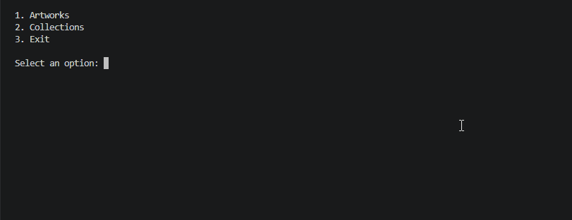
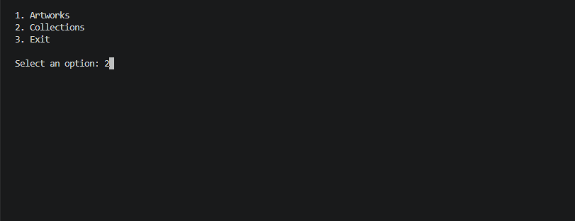
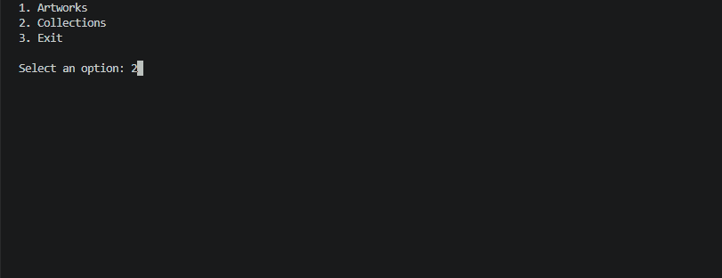
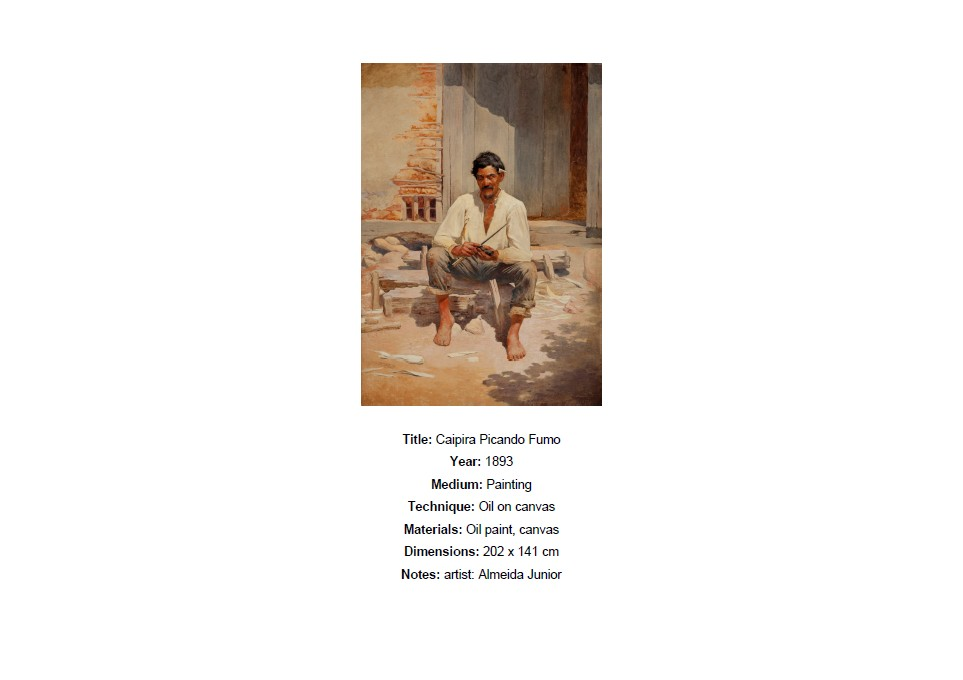

# Artwork Catalog

A command-line application built with Python for organizing, managing, and documenting artworks and collections.

Artwork Catalog allows users to maintain a local archive of their work, organize artworks into collections, search their catalog, and generate PDF documents containing artwork images and information.

The project uses object-oriented programming, JSON-based persistence, and automated testing.

## Features

### Artwork Management

- Create artwork records with an associated image.
- Store artwork information, including:
  - Title and year
  - Medium, technique, and materials
  - Height, width, and optional depth
  - Measurement units
  - Optional notes
- Browse and search artworks by title.
- View and edit existing artwork information.
- Delete artworks with confirmation.
- Automatically remove deleted artworks from their associated collections.

### Collection Management

- Create collections with names and descriptions.
- Browse and search collections by name.
- Edit collection information.
- Add or remove multiple artworks.
- Prevent duplicate artwork entries within collections.
- Delete collections without deleting the artworks themselves.

### PDF Export

Generate PDF documents presenting artwork images alongside their catalog information.

- **Individual artwork:** A landscape A4 document displaying the artwork image and its metadata, including title, year, medium, technique, materials, dimensions, and optional notes.
- **Collection:** A multi-page PDF containing a collection cover page with its name and description, followed by individual artwork pages.

PDFs are generated using ReportLab, with image processing handled by Pillow.

### Data Persistence

Artwork and collection data are stored locally in JSON files (artworks.json and collections.json), which are automatically created when records are first saved. When the application is launched from the project's root directory, these files are stored there.

Each artwork and collection has a unique identifier, allowing collections to reference artworks without duplicating their information.

The application stores paths to artwork images rather than copies of the image files themselves. Therefore, the original images must remain accessible at their saved locations for image-dependent operations, such as PDF export. Moving or deleting an image may prevent these operations from working correctly.

### Command-Line Interface

The application provides an interactive, menu-driven interface with input validation, navigation options, and confirmation prompts for destructive operations.

## Application Preview

The following demonstrations showcase the main workflows of Artwork Catalog using public-domain Brazilian artworks.

### 1. Creating Artworks and Collections

Create an artwork record, enter its metadata, create a collection, and add the artwork to it.



### 2. Managing Collections

Add existing artwork records to a collection.



### 3. Exporting a Collection as PDF

Generate a PDF catalog containing a collection cover page and individual artwork pages.



#### Sample PDF Output

Below is an example of an artwork page generated by the application.



[View the complete sample PDF](assets/sample-catalog.pdf)

## Technologies

- **Python 3.14** — Application development
- **Pillow** — Image processing
- **ReportLab** — PDF generation
- **JSON** — Local data persistence
- **pytest** — Automated testing
- **pytest-cov** — Test coverage analysis

## Installation

### Prerequisites

- Python 3.14 (version used for development and testing)
- Git (optional, for cloning the repository)

### 1. Clone the repository

```bash
git clone https://github.com/ppaltieri/artwork-catalog.git
cd artwork-catalog
```

### 2. Create a virtual environment

```bash
python -m venv .venv
```

Activate the environment.

Windows (PowerShell):

```powershell
.\.venv\Scripts\Activate.ps1
```

macOS / Linux:

```bash
source .venv/bin/activate
```

### 3. Install dependencies

```bash
python -m pip install -r requirements.txt
```

## Usage

From the project's root directory, launch the application:

```bash
python -m artwork_catalog
```

The main menu provides three options:

```text
1. Artworks
2. Collections
3. Exit
```

Choose **Artworks** to create, browse, search, edit, delete, or export individual artwork records.

Choose **Collections** to create and manage groups of artworks, modify their contents, or export them as PDF documents.

When creating an artwork, follow the prompts to enter its image path and metadata. Use `/back` to return to the previous field or `/exit` to cancel the creation process.

Artwork image files must remain accessible at their saved paths for image-based operations such as PDF export.

The application creates and updates local JSON data files as records are saved.

## Testing

The project includes **323 automated tests**, written using pytest, covering its 28 original application modules.

The test suite achieves **100% statement coverage** across those modules. The small package entry-point wrapper is excluded from coverage reporting.

Install the development dependencies:

```bash
python -m pip install -r requirements-dev.txt
```

Run all tests:

```bash
python -m pytest tests/ -v
```

Run tests with coverage reporting:

```bash
python -m pytest tests/ --cov=artwork_catalog --cov-report=term-missing
```

## Project Structure

```text
artwork-catalog/
├── artwork_catalog/
│   ├── __init__.py
│   ├── __main__.py
│   ├── artwork.py
│   ├── collection.py
│   ├── dimensions.py
│   ├── artwork_storage.py
│   ├── collection_storage.py
│   ├── export_pdf.py
│   ├── load.py
│   ├── ui.py
│   └── ...other application modules
├── tests/
│   └── test_*.py
├── .coveragerc
├── .gitignore
├── requirements.txt
└── requirements-dev.txt
```

The application separates data models, storage operations, input handling, menu navigation, collection management, and PDF generation into dedicated modules.

## Project Purpose

Artwork Catalog was developed to address a challenge faced by some visual artists: keeping an organized and accessible record of their work.

As an artist myself, I wanted to create a tool that simplifies the process of documenting artworks, managing collections, and generating catalogs that can be used for reference, presentation, or archival purposes.

The application currently operates through a command-line interface (CLI), providing a functional foundation for a more accessible artwork management tool in the future.

While developing the application, I also had the opportunity to apply and strengthen my Python programming skills, particularly in:

- Object-oriented programming and data modeling
- Modular application design and Python packages
- File handling and JSON serialization
- User input validation and interactive CLI workflows
- Image processing and PDF generation
- Automated unit testing using pytest
- Test isolation using fixtures and mocking
- Version control with Git

The project is designed to run locally without requiring a database server or external API.

## Future Improvements

Artwork Catalog currently provides a functional command-line application for managing artwork records and collections.

Potential future developments include:

- **Graphical user interface (GUI):** Make the application more accessible to artists without programming experience.
- **Mobile applications:** Develop dedicated applications for Android and iOS, allowing artists to manage their catalogs directly from their smartphones.
- **Cloud synchronization:** Enable users to access and synchronize their artwork records and collections across multiple devices.
- **Image management:** Explore options for managing artwork images directly within the application rather than relying on external file paths.

These are potential directions for future development rather than committed features.

## Sample Artwork Credits

The artworks featured in the application demonstration are public-domain works by Brazilian artists, sourced from Wikimedia Commons.

- **[Caipira picando fumo](https://commons.wikimedia.org/wiki/File:Caipira_picando_fumo.jpg)** — Almeida Júnior (1893)
- **[O violeiro](https://commons.wikimedia.org/wiki/File:Almeida_J%C3%BAnior_-_O_Violeiro.jpg)** — Almeida Júnior (1899)
- **[Moema](https://commons.wikimedia.org/wiki/File:Victor_Meirelles_-_Moema.jpg)** — Victor Meirelles (1866)

The images are used for demonstration purposes only. Artwork titles, dates, and dimensions are attributed to their respective museum collections.